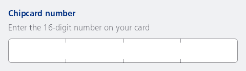

#### Labeled chipcard input in a form row



```kotlin
var value by remember { mutableStateOf("") }
NesChipcard(
    label = "Chipcard number",
    value = value,
    helpText = "Enter the 16-digit number on your card",
    onValueChange = { value = it }
)
```

