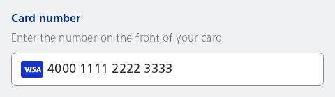
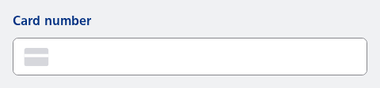
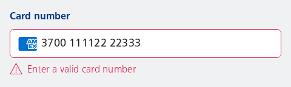
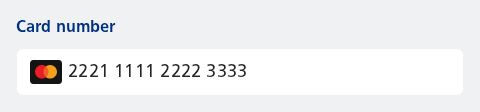

#### Default creditcard input

The card type and its logo are detected from the number, which is grouped automatically.



```kotlin
var value by remember { mutableStateOf("4000111122223333") }
NesCreditcard(
    label = "Card number",
    helpText = "Enter the number on the front of your card",
    value = value,
    onValueChange = { value = it },
)
```

#### Empty creditcard input



```kotlin
var value by remember { mutableStateOf("") }
NesCreditcard(
    label = "Card number",
    value = value,
    onValueChange = { value = it },
)
```

#### Creditcard input in error state



```kotlin
var value by remember { mutableStateOf("3700111122223333") }
NesCreditcard(
    label = "Card number",
    errorMessage = "Enter a valid card number",
    value = value,
    onValueChange = { value = it },
    isError = true,
)
```

#### Borderless creditcard input



```kotlin
var value by remember { mutableStateOf("2221111122223333") }
NesCreditcard(
    label = "Card number",
    value = value,
    onValueChange = { value = it },
    border = false,
)
```

