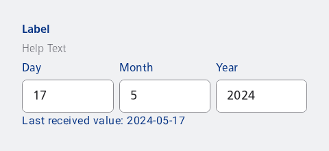
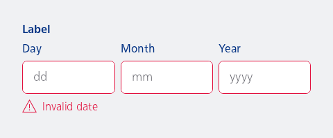

#### Date input

Enter a date by typing the day, month and year in separate fields. Focus moves to the next field when the user confirms the current one.



```kotlin
var value by remember { mutableStateOf<LocalDate?>(LocalDate.of(2024, 5, 17)) }

NesFormRow(
    label = "Label",
    helpText = "Help Text",
    modifier = Modifier.padding(NesTokens.layout.spaceAppInsetDefault),
    testTag = "date-input-example-row"
) {
    NesDateInput(
        value = value,
        onError = {},
        onValueChanged = { value = it }
    )
    NesText(
        text = "Last received value: $value"
    )
}
```

#### Date input with error

Show an error message when the entered date is not valid. Update `isError` whenever `onError` is called.



```kotlin
var value by remember { mutableStateOf<LocalDate?>(null) }
var errorMessage by remember { mutableStateOf<String?>("Invalid date") }

NesFormRow(
    label = "Label",
    errorMessage = errorMessage,
    modifier = Modifier.padding(NesTokens.layout.spaceAppInsetDefault),
    testTag = "date-input-error-example-row"
) {
    NesDateInput(
        value = value,
        isError = errorMessage != null,
        onError = { errorMessage = it },
        onValueChanged = { value = it }
    )
}
```

