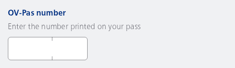

#### Labeled OV-Pas input in a form row



```kotlin
var value by remember { mutableStateOf("") }
NesOVPasInput(
    label = "OV-Pas number",
    value = value,
    helpText = "Enter the number printed on your pass",
    onValueChange = { value = it }
)
```

