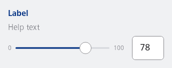
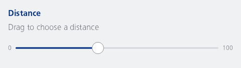
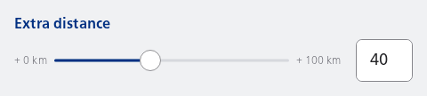
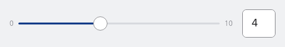

#### Range slider with a label and help text

Drag the thumb or edit the numeric input to update the same hoisted value. Uses the Figma Default example's content and 312dp component width in documentation snapshots.



```kotlin
var value by remember { mutableIntStateOf(78) }
NesRangeSlider(
    min = 0,
    max = 100,
    value = value,
    onValueChange = { value = it },
    label = "Label",
    helpText = "Help text",
    testTag = "distance"
)
```

#### Range slider without a numeric input



```kotlin
var value by remember { mutableIntStateOf(40) }
NesRangeSlider(
    min = 0,
    max = 100,
    value = value,
    onValueChange = { value = it },
    label = "Distance",
    helpText = "Drag to choose a distance",
    hiddenTextInput = true,
    testTag = "distance"
)
```

#### Range slider with leading and trailing units

Units are displayed alongside the minimum and maximum labels.



```kotlin
var value by remember { mutableIntStateOf(40) }
NesRangeSlider(
    min = 0,
    max = 100,
    value = value,
    onValueChange = { value = it },
    label = "Extra distance",
    leadingUnit = "+",
    trailingUnit = "km",
    testTag = "extra-distance"
)
```

#### Range slider without a form label

Prefer a labeled slider so its purpose is announced on both input controls.



```kotlin
var value by remember { mutableIntStateOf(4) }
NesRangeSlider(
    min = 0,
    max = 10,
    value = value,
    onValueChange = { value = it },
    testTag = "range"
)
```

