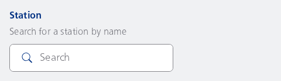
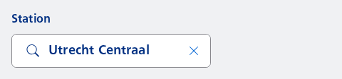
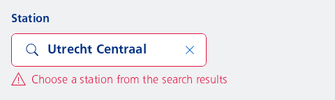
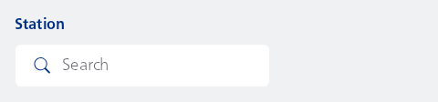

#### Default search input



```kotlin
var value by remember { mutableStateOf(TextFieldValue("")) }
NesSearchInput(
    label = "Station",
    helpText = "Search for a station by name",
    value = value,
    onValueChange = { value = it },
    placeholder = "Search",
)
```

#### Search input with a value

A clear button is shown when the search input has a value.



```kotlin
var value by remember { mutableStateOf(TextFieldValue("Utrecht Centraal")) }
NesSearchInput(
    label = "Station",
    value = value,
    onValueChange = { value = it },
    placeholder = "Search",
)
```

#### Search input in error state



```kotlin
var value by remember { mutableStateOf(TextFieldValue("Utrecht Centraal")) }
NesSearchInput(
    label = "Station",
    errorMessage = "Choose a station from the search results",
    value = value,
    onValueChange = { value = it },
    isError = true,
)
```

#### Borderless search input



```kotlin
var value by remember { mutableStateOf(TextFieldValue("")) }
NesSearchInput(
    label = "Station",
    value = value,
    onValueChange = { value = it },
    placeholder = "Search",
    border = false,
)
```

