#### Default text field

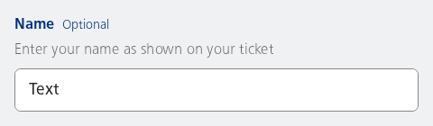

```kotlin
var value by remember { mutableStateOf("Text") }
NesTextField(
    label = "Name",
    helpText = "Enter your name as shown on your ticket",
    optional = true,
    value = value,
    onValueChange = { value = it },
)
```

#### Text field with placeholder

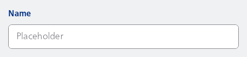

```kotlin
var value by remember { mutableStateOf("") }
NesTextField(
    label = "Name",
    value = value,
    onValueChange = { value = it },
    placeholder = "Placeholder",
)
```

#### Text field with leading and trailing icons

Leading icons are aligned in a fixed container; trailing icons are placed as-is, so use an icon button for actions.

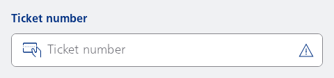

```kotlin
var value by remember { mutableStateOf("") }
NesTextField(
    label = "Ticket number",
    value = value,
    onValueChange = { value = it },
    placeholder = "Ticket number",
    leadingIcon = {
        NesIcon(
            icon = R.drawable.ic_nes_32x32_ticket,
            contentDescription = null
        )
    },
    trailingIcon = {
        NesIcon(
            icon = R.drawable.ic_nes_32x32_alert,
            contentDescription = "Alert"
        )
    },
)
```

#### Text field in error state

The form row displays the error message, which is also announced on the input.

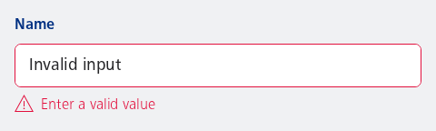

```kotlin
var value by remember { mutableStateOf("Invalid input") }
NesTextField(
    label = "Name",
    value = value,
    onValueChange = { value = it },
    isError = true,
    errorMessage = "Enter a valid value",
)
```

#### Borderless text field

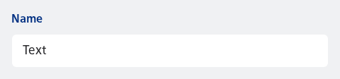

```kotlin
var value by remember { mutableStateOf("Text") }
NesTextField(
    label = "Name",
    value = value,
    onValueChange = { value = it },
    border = false,
)
```

#### Read-only text field

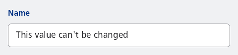

```kotlin
var value by remember { mutableStateOf("This value can't be changed") }
NesTextField(
    label = "Name",
    value = value,
    onValueChange = { value = it },
    readOnly = true,
)
```

#### Multiline text field

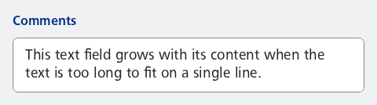

```kotlin
var value by remember { mutableStateOf("This text field grows with its content when the text is too long to fit on a single line.") }
NesTextField(
    label = "Comments",
    value = value,
    onValueChange = { value = it },
    singleLine = false,
)
```

#### Password text field

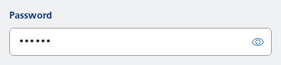

```kotlin
var value by remember { mutableStateOf("secret") }
var visibility by remember { mutableStateOf(Visibility.Hidden) }
NesTextField(
    label = "Password",
    value = value,
    onValueChange = { value = it },
    showVisibilityToggle = true,
    visibilityToggleState = visibility,
    onVisibilityToggleClicked = {
        visibility = if (visibility == Visibility.Hidden) Visibility.Visible else Visibility.Hidden
    },
    visualTransformation = if (visibility == Visibility.Hidden) {
        PasswordVisualTransformation()
    } else {
        VisualTransformation.None
    },
    keyboardOptions = KeyboardOptions(keyboardType = KeyboardType.Password),
)
```

#### Text field with a maximum length

Input beyond [maxLength] characters is ignored.

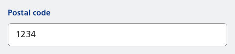

```kotlin
var value by remember { mutableStateOf("1234") }
NesTextField(
    label = "Postal code",
    value = value,
    onValueChange = { value = it },
    placeholder = "Postal code",
    maxLength = 6,
)
```

#### Text field with custom colors

Use [NesTextFieldDefaults.textFieldColors] to override colors for specific states.

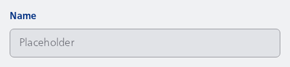

```kotlin
var value by remember { mutableStateOf("") }
NesTextField(
    label = "Name",
    value = value,
    onValueChange = { value = it },
    placeholder = "Placeholder",
    colors = NesTextFieldDefaults.textFieldColors(
        backgroundColor = NesTokens.colors.contentBackgroundAlphaSubtle,
        unfocusedBorderColor = NesTokens.colors.contentBorderStrong
    ),
)
```

#### Text field with a TextFieldValue

Use the [TextFieldValue] overload to control the selection and cursor position.

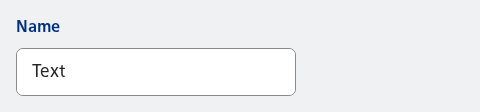

```kotlin
var value by remember { mutableStateOf(TextFieldValue("Text", selection = TextRange(4))) }
NesTextField(
    label = "Name",
    value = value,
    onValueChange = { value = it },
)
```

